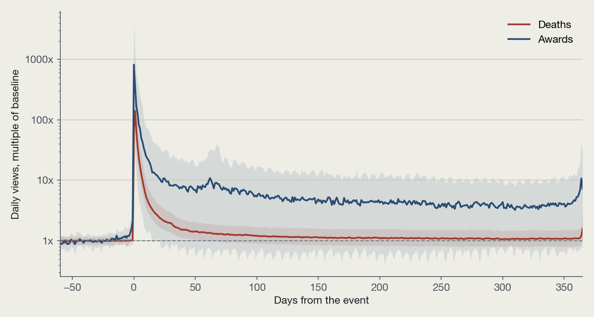

# Fame Half-Life

How fast does the world stop looking someone up? This project measures the spike in daily English Wikipedia pageviews around 1,905 deaths and 175 major awards from 2016 to October 2025, tests which curve the fade follows, and checks where attention settles a year later. The page also has a live box that fetches any article's views from Wikimedia and fits the same curves in your browser.

[Interactive site](https://lyhjeremy.github.io/fame-half-life/) · [Write-up](https://lyhjeremy.github.io/fame-half-life/overview/) · [Long-form notes](writeup.md) · [Privacy](https://lyhjeremy.github.io/fame-half-life/privacy/)

Design and copy follow [these standards](https://github.com/lyhjeremy/lyhjeremy/blob/main/DESIGN_STANDARDS.md).

## Results

- Peak: on the median death a page draws 200 times its baseline at the peak (middle half 107 to 388 times); the peak is the day after the death in 43% of cases.
- Half-life, as specified: 1 day for deaths and 1 for awards; one day for 95% of deaths with a spike. With 3-day smoothing the median is 2 days.
- After week one: 29% of a death's first-year excess views (median) arrive more than a week after the peak; for awards 44%.
- Curve shape: the biexponential has the lowest AIC for 90% of 1,947 fitted events (91% of deaths, 78% of awards); median fast time constant 5.4 days.
- Lift a year later: 1.08 times baseline for deaths (59% above 1), 8.78 for Nobel laureates, 0.38 for Academy Award winners.
- Among deaths, each extra year of age at death goes with 2.0% less lift (p < 0.001).



## Events

| Type | Rule | Candidates | Analyzed |
|---|---|---|---|
| Deaths | humans with an English article, 30+ Wikidata sitelinks, day-precision death date, 1 Jan 2016 to 31 Oct 2025 | 1,995 | 1,905 |
| Awards | Nobel Prizes (all six), Academy Awards (four acting categories and Best Director), Ballon d'Or, Booker Prize | 188 | 175 |

The list was frozen in `data/events.csv` and committed before any pageview was fetched. Exclusions: article created less than 30 days before the event (21 deaths, 5 awards), article renamed inside the window (65), baseline under one view a day (12). Every data decision is in [`docs/decisions.md`](docs/decisions.md).

## Measures

| Measure | Definition |
|---|---|
| Baseline | median daily views, days -60 to -8 |
| Peak | maximum daily views, days 0 to +3 |
| Half-life | days from the peak until the centered 7-day mean of excess views falls below half the peak excess |
| After week one | share of the first year's excess views that arrive more than 7 days after the peak |
| Lift | median views on days +335 to +365 divided by baseline |

Views are adjusted for day of week using factors from the baseline window. Three decay models (exponential, power law, and the biexponential form of Candia et al. 2019) are fitted to log excess views after the peak and compared by AIC.

## How to run

```bash
pip install -r requirements.txt
export FAME_CACHE=~/data-cache/fame-half-life   # raw responses, outside the repo
python scripts/fetch_events.py      # Wikidata, Nobel API, Wikipedia -> data/events.csv (frozen)
python scripts/fetch_pageviews.py   # Wikimedia pageviews and rename check -> data/series.csv.gz, data/fetch_log.csv
python scripts/analyze.py           # results/ and tables/
python scripts/make_figures.py      # figures/
python scripts/export_numbers.py    # site/numbers.json
python scripts/export_web.py        # assets/data.json, assets/series/
python scripts/build_site.py        # index.html, README.md, writeup.md, write-up fragment
python scripts/check_fit_parity.py  # browser fits against Python fits (needs node)
```

The processed series are committed, so `analyze.py` onward runs without network access. The fetchers are slow on purpose: about two requests a second, with every response cached.

## Repo layout

| Path | Contents |
|---|---|
| `queries/` | SPARQL text for deaths, Academy Awards, Booker winners and occupation groups |
| `scripts/` | fetchers, `fits.py` (measures and models), analysis, figures, site builders |
| `data/` | the frozen event list, fetch log and daily series |
| `results/`, `tables/` | every number the pages quote |
| `index.html`, `assets/` | the interactive page; `assets/fit.js` is a line-for-line port of `scripts/fits.py` |
| `overview/` | the write-up, generated from `site/overview.fragment.html` by the shared overview builder |
| `privacy/` | what the live lookup sends to Wikimedia |

Stack: Python (pandas, NumPy, statsmodels, matplotlib) and plain HTML, CSS and JavaScript with no libraries. Hosted on GitHub Pages; no server.

## Sources

- Pageviews: [Wikimedia REST API](https://wikimedia.org/api/rest_v1/), `per-article/en.wikipedia/all-access/user/daily`.
- Events: [Wikidata Query Service](https://query.wikidata.org/), the [Nobel Prize API](https://www.nobelprize.org/about/developer-zone-2/), and English Wikipedia articles on each year's Ballon d'Or and Booker Prize.
- Candia, C., Jara-Figueroa, C., Rodriguez-Sickert, C., Barabási, A.-L. and Hidalgo, C. A. (2019). The universal decay of collective memory and attention. *Nature Human Behaviour* 3, 82–91. [doi:10.1038/s41562-018-0474-5](https://doi.org/10.1038/s41562-018-0474-5)

## License

Code under the MIT License. Pageview data from the Wikimedia Foundation (CC0); Wikidata content is CC0.
